# DecisionRAG: retrieval by navigating, not searching

A runnable implementation of the idea in **"Retriever-Free Retrieval: Navigating Documents with
Decision Models"** (Wan, Jünger, Du, Liu, Krishnan, Weinberger; arXiv:2610.35868v1 [cs.AI],
26 Oct 2026). Instead of scoring every passage with BM25 or an embedding index, a *decision model*
walks the corpus the way a person browses a library: from broad topics, to documents, to
sections, to the individual passage, deciding at each level which branches are worth opening.

> **Read this first.** This folder follows the paper's pipeline as shown in its Figure 2 and
> abstract: yes/no *document screening* (keep top k), yes/no *passage scoring* over only the kept
> documents (keep top r), and an *optional choice reranking* (one multiple-choice question over the
> top r). It was written from the title, abstract, Figures 1 and 2, and a related-work excerpt, **not
> from the full text**, so unseen details (default k and r, prompts, tree construction per dataset)
> are this example's choices. Things added beyond the figure are labelled "this example": the
> tournament for candidate sets larger than a context, abstaining on weak evidence, an optional
> probability floor, and skipping the model call when a step has one option. The paper's numbers are
> quoted, not reproduced: no benchmark was run here.

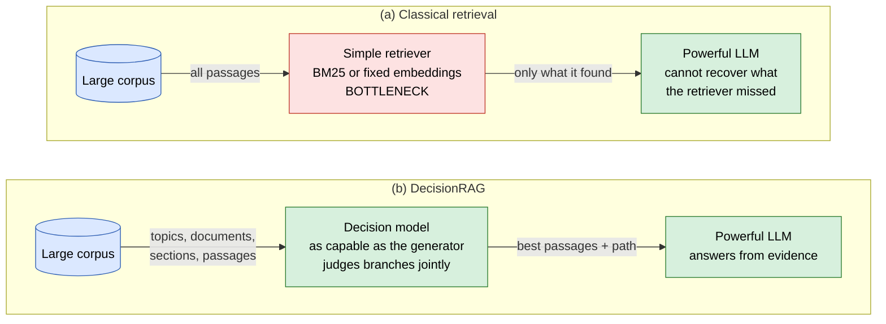

## The idea in five points

1. **Capability asymmetry.** A strong generator cannot recover what a weak retriever never
   surfaced. Retrieval is the bottleneck.
2. **Decision models fix the asymmetry.** A decision model (the paper cites TypeSafe's Jev) takes a
   context and a set of questions and returns, for each, a probability distribution over answer
   options (for yes/no, `P(yes)`) in **one forward pass, generating no tokens**.
3. **Judge candidates together.** Putting all candidates in one shared context makes their
   relevance estimates *comparable*. The paper reports this contributes up to 7.7 points over
   judging them independently. This folder lets you test that on your data
   ([joint vs independent](docs/jev-integration.md)).
4. **Navigate the structure the corpus already has, in three stages.** Screen documents (keep
   k), score the passages of the kept documents only (keep r; pruned documents are never
   expanded), then optionally rerank the top r with one multiple-choice question. Latency is a
   handful of fast calls, not an agentic loop of generated tokens.
5. **No first-stage retriever, no precomputed index, no task-specific training.**

Paper-reported results (not reproduced here): +13.8 R@1 over dense retrieval with an 8B reranker on
MultiDoc2Dial, +17.4 Hit@1 on Natural Questions, and 0.7 to 1.8 seconds per query across four
benchmarks including a 2.68 million paragraph Wikipedia corpus. A further step is reported to raise
R@1 on MultiDoc2Dial to 60.7, 5.7 points above the best compared published task-trained retriever
(the excerpt this is taken from starts mid-sentence, so which configuration that is, most likely
the one with reranking, is not confirmed here).

## How it works

The whole flow on one page, with a real run (source: [docs/diagrams/09-how-it-works.html](docs/diagrams/09-how-it-works.html)):

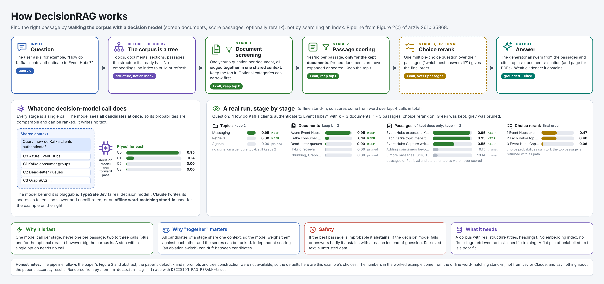

The pipeline, as drawn in the paper's Figure 2(c):

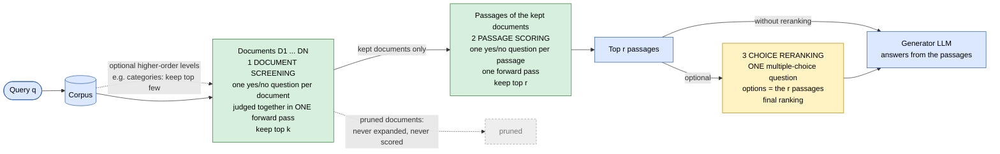

The tree it walks (sections are folded away by default, so passage scoring sees passages
directly, with the section title kept as context in each candidate):

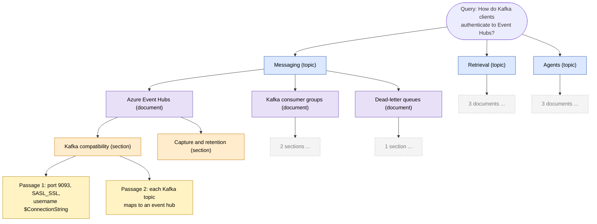

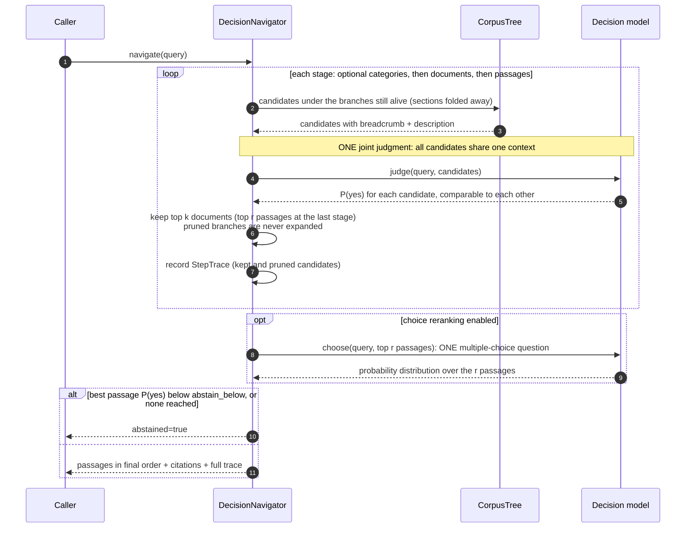

Every stage is **one joint judgment**: all candidates, one context, one decision-model call. A
query costs one call per stage (two or three, plus one for the optional rerank) however large the
corpus is; a step with a single option needs no call at all. That is why the technique is fast.
The keep, rerank and abstain rules:

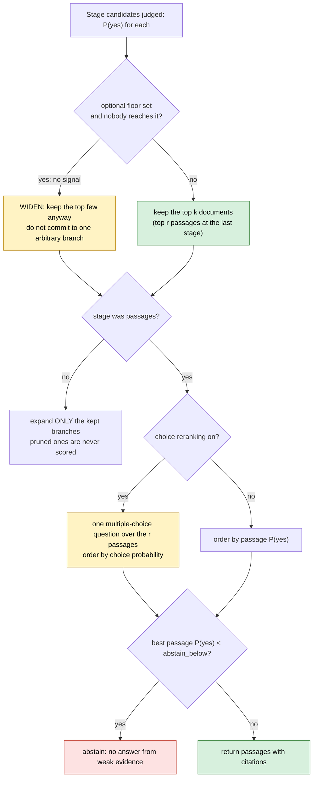

## Quick start

No key or network is needed; the default decision model is an offline lexical stand-in.

```bash
make install
uv run python -m decision_rag "How do Kafka clients authenticate to Event Hubs?"
uv run python -m decision_rag "What should I do with a poison message that retries cannot fix?" --trace
uv run python -m decision_rag "..." --mermaid trace.mmd      # the navigation as a diagram
uv run python -m decision_rag.evaluate                       # golden-set check
uv run pytest agents/decision_rag
```

Output of the first command (real, from the offline stand-in):

```json
{
  "abstained": false,
  "reason": null,
  "answer": "Event Hubs exposes a Kafka endpoint on port 9093, so Kafka clients connect with SASL_SSL and the username $ConnectionString plus an Event Hubs connection string.",
  "citations": [
    {
      "path": "Messaging > Azure Event Hubs > Kafka compatibility > Passage 1",
      "source": null,
      "probability": 0.95
    },
    {
      "path": "Messaging > Azure Event Hubs > Kafka compatibility > Passage 2",
      "source": null,
      "probability": 0.949
    },
    {
      "path": "Messaging > Azure Event Hubs > Capture and retention > Passage 1",
      "source": null,
      "probability": 0.548
    }
  ]
}
```

### Watch it navigate

`--trace` prints every candidate the model judged at each stage:

```text
step 1 (topic stage): 3 candidates, 1 call(s)
  KEEP 0.00  [topic] Messaging
  KEEP 0.00  [topic] Retrieval
       0.00  [topic] Agents

step 2 (document stage): 6 candidates, 1 call(s)
  KEEP 0.95  [document] Dead-letter queues
  KEEP 0.15  [document] Kafka consumer groups
  KEEP 0.00  [document] Azure Event Hubs
       0.00  [document] Hybrid retrieval
       0.00  [document] Chunking strategies
       0.00  [document] GraphRAG

step 3 (passage stage): 8 candidates, 1 call(s)
  KEEP 0.95  [passage] Send a message to the dead-letter topic when re…
  KEEP 0.14  [passage] A consumer commits the offset of the next messa…
  KEEP 0.00  [passage] Store the failure reason and attempt count with…
       0.00  [passage] A consumer group splits a topic's partitions be…
       0.00  [passage] Adding consumers beyond the number of partition…
       0.00  [passage] Event Hubs exposes a Kafka endpoint on port 909…
       0.00  [passage] Each Kafka topic maps to an event hub inside th…
       0.00  [passage] Event Hubs Capture writes streaming events to A…

3 decision-model call(s) in 1 ms
```

The same run as a diagram (`--mermaid`). Green was kept, grey was pruned, gold is the answer,
dotted edges are pruned branches. The lexical stand-in saw nothing relevant at the topic level
(`p=0.00` for every topic), so the top-k rule kept two topics anyway; the document stage then found
"Dead-letter queues", and only the passages of the kept documents were scored.

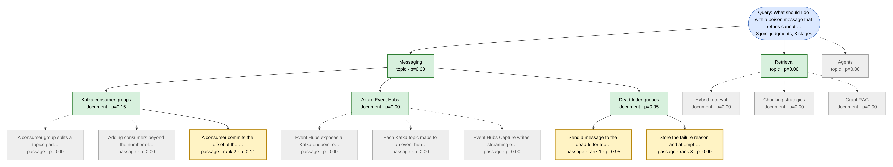

With the optional choice rerank on (`DECISION_RAG_RERANK=true`) a last stage asks one
multiple-choice question over the top r passages. Each passage shows its rank, its own yes/no
probability and its choice probability:

```text
step 1 (topic stage): 3 candidates, 1 call(s)
  KEEP 0.95  [topic] Messaging
  KEEP 0.00  [topic] Retrieval
       0.00  [topic] Agents

step 2 (document stage): 6 candidates, 1 call(s)
  KEEP 0.95  [document] Azure Event Hubs
  KEEP 0.14  [document] Kafka consumer groups
  KEEP 0.00  [document] Dead-letter queues
       0.00  [document] Hybrid retrieval
       0.00  [document] Chunking strategies
       0.00  [document] GraphRAG

step 3 (passage stage): 8 candidates, 1 call(s)
  KEEP 0.95  [passage] Event Hubs exposes a Kafka endpoint on port 909…
  KEEP 0.95  [passage] Each Kafka topic maps to an event hub inside th…
  KEEP 0.55  [passage] Event Hubs Capture writes streaming events to A…
       0.15  [passage] Adding consumers beyond the number of partition…
       0.14  [passage] A consumer group splits a topic's partitions be…
       0.13  [passage] A consumer commits the offset of the next messa…
       0.00  [passage] Send a message to the dead-letter topic when re…
       0.00  [passage] Store the failure reason and attempt count with…

step 4 (choice rerank): 3 candidates, 1 call(s)
  KEEP 0.47  [passage] Event Hubs exposes a Kafka endpoint on port 909…
  KEEP 0.46  [passage] Each Kafka topic maps to an event hub inside th…
  KEEP 0.06  [passage] Event Hubs Capture writes streaming events to A…

4 decision-model call(s) in 1 ms
```

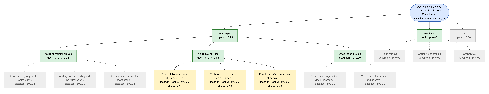

A confident run, and one that abstains:

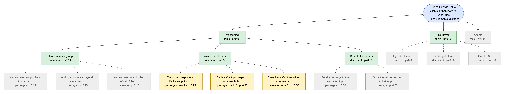

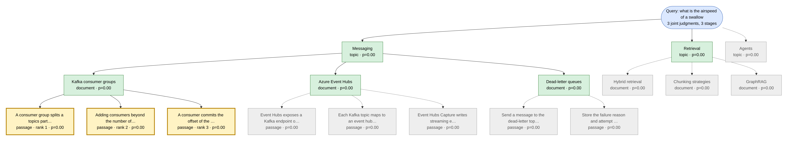

Every diagram in this folder is also available as a rendered PNG and SVG in
[docs/images](docs/images) (sources in [docs/diagrams](docs/diagrams)).

### On your own documents

```bash
uv run python -m decision_rag --corpus docs "How is the system deployed?" --trace
```

`--corpus` takes a folder (or one file) of Markdown and PDF: folders become topics, files
documents, `##` headings or bold PDF sub-headings sections, paragraphs passages. Fenced code
(including Mermaid) and hidden folders are skipped.

## Use a real decision model (TypeSafe Jev)

```bash
export DECISION_RAG_BACKEND=jev
export DECISION_RAG_API_KEY=...            # never commit; use your secret manager
uv run python -m decision_rag "..." --trace
DECISION_RAG_JUDGEMENT=independent uv run python -m decision_rag.evaluate   # ablation
```

Jev is hosted and in early access. **Read [docs/jev-integration.md](docs/jev-integration.md)
first:** it states which parts of the HTTP shape are confirmed and which are assumed.

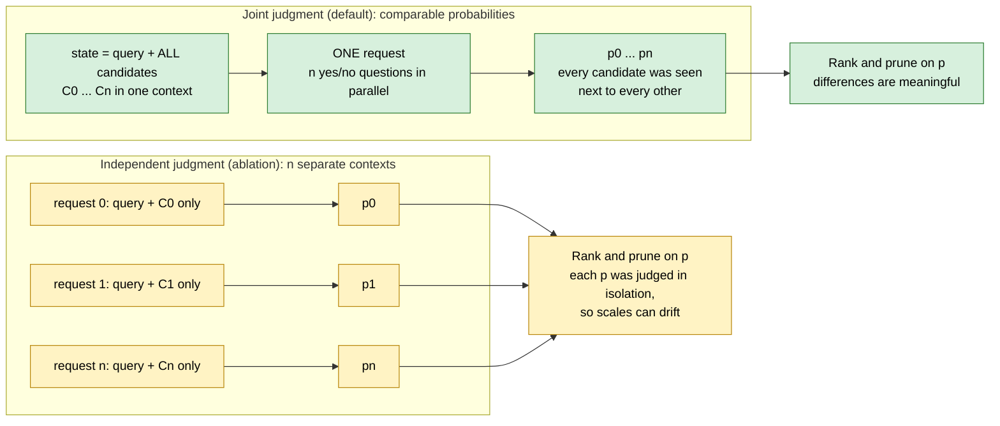

## Use Claude as the decision model

```bash
export ANTHROPIC_API_KEY=...                  # or an `ant auth login` profile; never commit a key
export DECISION_RAG_BACKEND=claude            # model: claude-opus-5-5 by default
uv run python -m decision_rag "..." --trace
uv run python -m decision_rag.evaluate --suite project-slm
```

[`claude.py`](src/decision_rag/claude.py) uses the official Anthropic SDK. All candidates of a level
go into **one request**, so Claude judges them in a shared context, and the reply is constrained to
a JSON schema and validated again (every candidate scored once, each within 0 to 1). Change the
model with `DECISION_RAG_CLAUDE_MODEL` (for example a cheaper model for a trial) and the effort with
`DECISION_RAG_CLAUDE_EFFORT` (`low` by default, because a relevance score needs little reasoning).

Be clear about what this is. Claude writes its scores as tokens; it is not a forward-pass decision
model, so a call is slower and costlier than Jev and the numbers are self-reported estimates, not
calibrated probabilities. It is a good way to try the technique and to set a baseline; calibrate
thresholds on labelled data before trusting them. The adapter has been exercised only against a
fake SDK client in the tests. **A live Claude run has not been done in this repository's
development environment because no API key was available there**, so run the two commands above
once with your key and read the trace before relying on it.

## Sample data and PDF input

[`data/project_slm`](data/project_slm) holds 60 scenarios from a Project SLM requirement list
(Domains 1 to 7, as Markdown, one file per domain), and
[`data/project_slm_pdf`](data/project_slm_pdf) holds the same text as a 6-page PDF. Only the
supplied scenarios are included. Domain 8 was cut off in the source text and is omitted.

```bash
uv run python -m decision_rag --corpus agents/decision_rag/data/project_slm_pdf \
  "How are unit prices masked for a site planning engineer?" --trace
```

PDF structure comes from font size and weight (large title = document, bold sub-heading =
section, paragraph = passage), and each citation carries the page (`Project_SLM_Scenarios.pdf
p.3`). Wrapped titles are merged and ligatures and line-end hyphens or slashes are repaired. Not
handled: tables and images are not interpreted (table text is read as paragraphs), scanned PDFs
need OCR first, and a scenario that straddles a page break becomes two passages. Rebuild the
sample PDF with `python -m decision_rag.sample_pdf agents/decision_rag/data/project_slm <out.pdf>`.

Result of the golden set over the scenarios, 13 questions with the offline stand-in (a plumbing
check, not evidence about accuracy):

```text
suite              project-slm
queries            13
navigator Hit@1    0.77
flat lexical Hit@1 0.92
decision-model calls per query 2.0
mean latency       3.7 ms
```

The same questions with the optional choice rerank on (`DECISION_RAG_RERANK=true`):

```text
suite              project-slm
queries            13
navigator Hit@1    0.85
flat lexical Hit@1 0.92
decision-model calls per query 3.0
mean latency       3.8 ms
```

The architecture these scenarios describe is drawn in [docs/project-slm](../../docs/project-slm/README.md).

## Honest evaluation

`python -m decision_rag.evaluate` compares navigation with a flat lexical retriever on a 10-query
golden set over the built-in 17-passage corpus. Result with the offline stand-in:

```text
suite              sample
queries            10
navigator Hit@1    1.00
flat lexical Hit@1 1.00
decision-model calls per query 3.0
mean latency       0.5 ms
```

**This is a plumbing check, not evidence about DecisionRAG.** The stand-in matches words, so it
cannot understand paraphrases ("authenticate" does not match "SASL"), and a flat word-matcher
legitimately beats a hierarchy of word-matchers on a tiny corpus. The paper's gains come from a
*language-model* decision model; to measure them, run this harness with Jev on a labelled set of
your own questions. [docs/evaluation.md](docs/evaluation.md) says how.

## Architecture

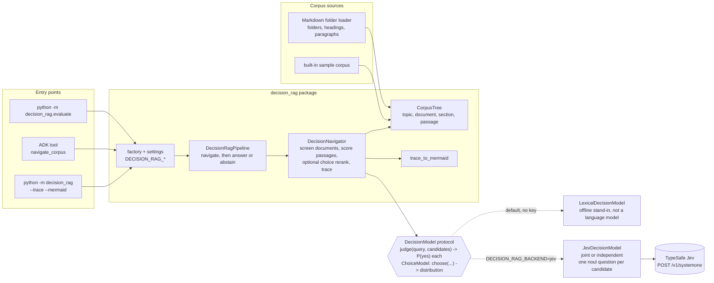

```text
src/decision_rag/
  corpus.py            CorpusTree: topic > document > section > passage, extractive descriptions
  sample_corpus.py     built-in corpus + golden questions
  models.py            Candidate and the DecisionModel protocol
  navigator.py         screen documents, score passages, optional choice rerank, trace
  local.py             offline stand-in decision model (NOT a language model)
  jev.py               TypeSafe Jev adapter: joint or independent, noul questions only
  claude.py            Claude adapter (Anthropic SDK): one structured request per level
  loaders.py           folder, Markdown and PDF loaders (page-aware citations)
  sample_pdf.py        build the sample PDF from Markdown
  slm_golden.py        13 questions over the Project SLM scenarios
  pipeline.py          navigate, then answer or abstain; fails safe when the model is down
  mermaid.py           render a real trace as a diagram
  evaluate.py          golden-set harness vs a flat lexical retriever
  adk_agent.py         ADK agent with a navigate_corpus tool (agents-cli entrypoint)
  factory.py settings.py __main__.py
tests/                 corpus, navigator, Jev adapter (mock transport), pipeline, docs-in-sync
docs/                  concepts, algorithm, Jev integration, evaluation, diagrams, images
```

## Configuration (`DECISION_RAG_*`)

| Variable | Default | Meaning |
|---|---|---|
| `BACKEND` | `local` | `local` offline stand-in, `jev`, or `claude` |
| `CLAUDE_MODEL`, `CLAUDE_EFFORT` | `claude-opus-5-5`, `low` | model and effort for the `claude` backend |
| `JUDGEMENT` | `joint` | `joint` one request per level; `independent` one per candidate (ablation) |
| `API_KEY`, `BASE_URL`, `MODEL`, `TIMEOUT_SECONDS` | unset, TypeSafe, `jev-latest`, 10 | Jev connection |
| `CORPUS_DIR` | unset | Markdown folder; unset uses the sample corpus |
| `KEEP_TOPICS` | 2 | higher-order levels (categories) kept |
| `KEEP_DOCUMENTS` | 3 | **k**: documents kept after screening |
| `KEEP_PASSAGES` | 3 | **r**: passages kept after scoring (and reranked) |
| `KEEP_SECTIONS`, `SKIP_SECTIONS` | 3, `true` | sections are folded away by default (paper layout: documents then passages) |
| `RERANK` | `false` | optional choice reranking over the top r (needs a model with `choose`) |
| `MIN_PROBABILITY` | 0 | this example: optional floor on P(yes); 0 is pure top-k as in the figure |
| `ABSTAIN_BELOW` | 0.3 | best passage under this probability: abstain |
| `MAX_CANDIDATES_PER_CALL` | 40 | context budget; more candidates run as a tournament |

## Safety and limits

- **Fails safe.** If the decision model errors, times out or returns an invalid shape, the
  pipeline abstains with reason `decision_model_unavailable`; it never answers from a guess.
- **Abstains** when the best passage is below `ABSTAIN_BELOW`.
- **Answers are extractive** (the best passage verbatim, with its topic > document > section
  path as the citation). Retrieved text is untrusted data; the ADK agent is told never to follow
  instructions found in it.
- **Navigation can dead-end on weak titles.** If a topic or document description does not mention
  what the query needs, the right branch may score low and be pruned. Better descriptions, a
  larger k, or a stronger decision model are the fixes; the trace shows where it happened.
- **No ingestion index to maintain,** but quality depends on the corpus having meaningful
  structure (titles, headings). A flat pile of unlabelled text is a poor fit.
- Ticket or document text sent to a hosted decision model leaves your boundary. Do not send data
  you could not send to any other API.

## More

- [Concepts](docs/concepts.md): the paper's argument, vocabulary, when to use this
- [Algorithm](docs/algorithm.md): navigation, tournament, ranking, cost, design choices
- [Jev integration](docs/jev-integration.md): wire format status, joint vs independent
- [Evaluation](docs/evaluation.md): measure it honestly on your own data
- [Diagrams](docs/diagrams/README.md): sources, how to re-render

## Source

Wan, C., Jünger, P., Du, B., Liu, B., Krishnan, N., Weinberger, K. Q. *Retriever-Free Retrieval:
Navigating Documents with Decision Models.* arXiv:2610.35868v1 [cs.AI], 26 Oct 2026.
Decision model referenced there: TypeSafe AI's Jev, <https://docs.typesafe.ai/api/system-one>.
