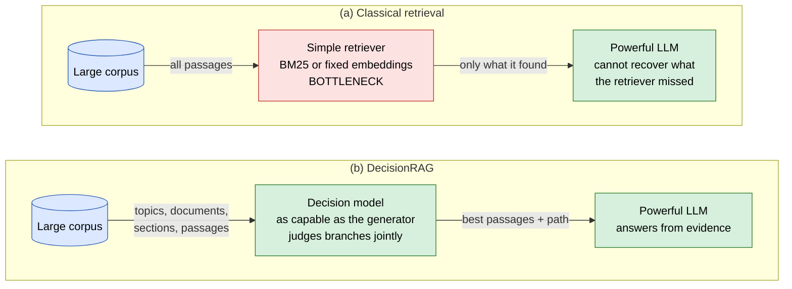
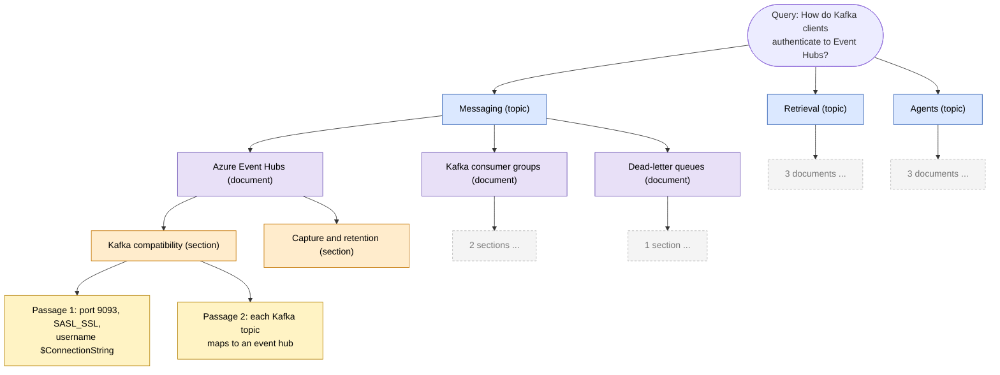
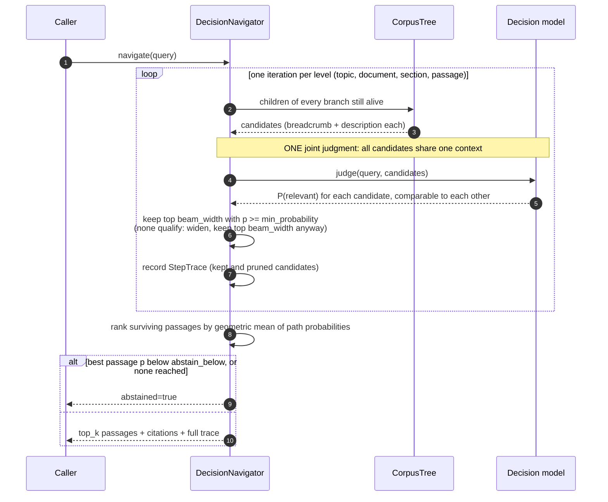
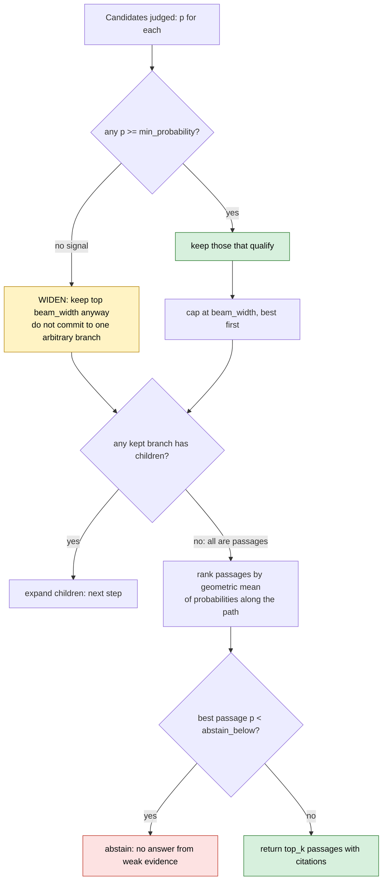
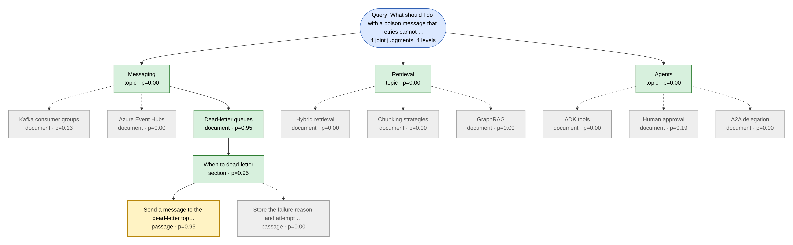
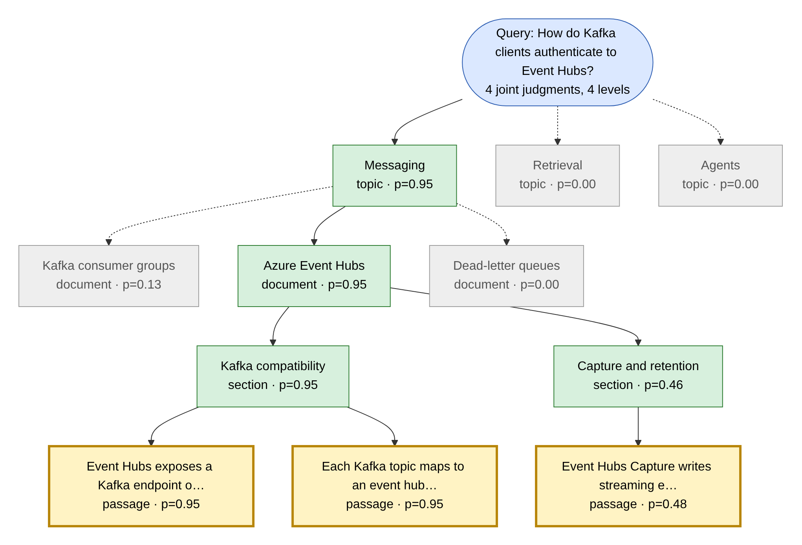
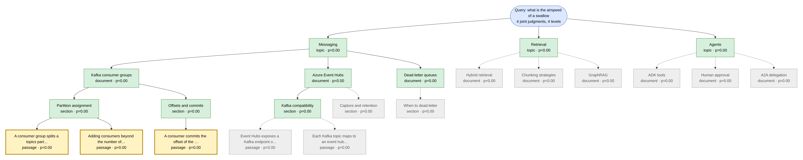
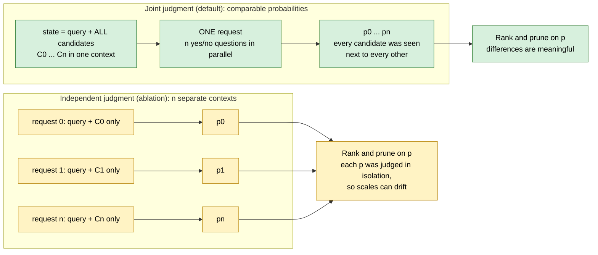
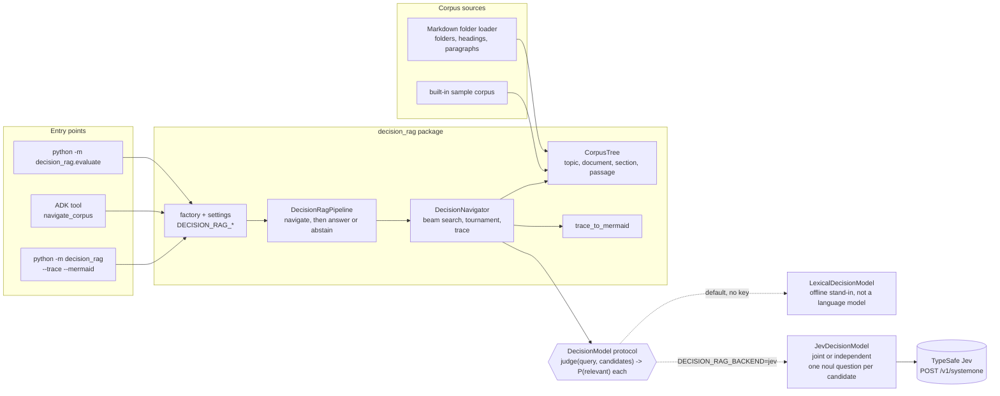

# DecisionRAG: retrieval by navigating, not searching

A runnable implementation of the idea in **"Retriever-Free Retrieval: Navigating Documents with
Decision Models"** (Wan, Jünger, Du, Liu, Krishnan, Weinberger; arXiv:2610.35868v1 [cs.AI],
26 Oct 2026). Instead of scoring every passage with BM25 or an embedding index, a *decision model*
walks the corpus the way a person browses a library: from broad topics, to documents, to
sections, to the individual passage, deciding at each level which branches are worth opening.

> **Read this first.** This folder was written from the title, abstract, Figure 1 and the first
> pages of the paper (the parts available when it was built), not from the full text. The core
> idea below is the paper's. Anything else (beam search, the tournament for oversized candidate
> sets, geometric-mean ranking, thresholds) is **this example's own design** and is labelled as
> such. The paper's reported numbers are quoted, not reproduced: no benchmark was run here.



## The idea in five points

1. **Capability asymmetry.** A strong generator cannot recover what a weak retriever never
   surfaced. Retrieval is the bottleneck.
2. **Decision models fix the asymmetry.** A decision model (the paper cites TypeSafe's Jev) takes a
   context and a set of questions and returns, for each, a probability distribution over answer
   options (for yes/no, `P(yes)`) in **one forward pass, generating no tokens**.
3. **Judge candidates together.** Putting all candidates in one shared context makes their
   relevance estimates *comparable*. The paper reports this contributes up to 7.7 points over
   judging them independently. This folder lets you test that on your data
   ([joint vs independent](docs/jev-integration.md)).
4. **Navigate the structure the corpus already has.** Topics, document titles, sections,
   passages. One decision per level, so latency is a handful of fast calls, not an agentic loop of
   generated tokens.
5. **No first-stage retriever, no precomputed index, no task-specific training.**

Paper-reported results (not reproduced here): +13.8 R@1 over dense retrieval with an 8B reranker on
MultiDoc2Dial, +17.4 Hit@1 on Natural Questions, and 0.7 to 1.8 seconds per query across four
benchmarks including a 2.68 million paragraph Wikipedia corpus.

## How it works





Every level is **one joint judgment**: all candidates, one context, one decision-model call. A
four-level corpus costs four calls however large it is, which is why the technique is fast. The
pruning rules, including what happens when the model sees nothing relevant and when to abstain:



## Quick start

No key or network is needed; the default decision model is an offline lexical stand-in.

```bash
make install
uv run python -m decision_rag "How do Kafka clients authenticate to Event Hubs?"
uv run python -m decision_rag "What should I do with a poison message that retries cannot fix?" --trace
uv run python -m decision_rag "..." --mermaid trace.mmd      # the navigation as a diagram
uv run python -m decision_rag.evaluate                       # golden-set check
uv run pytest agents/decision_rag
```

Output of the first command (real, from the offline stand-in):

```json
{
  "abstained": false,
  "reason": null,
  "answer": "Event Hubs exposes a Kafka endpoint on port 9093, so Kafka clients connect with SASL_SSL and the username $ConnectionString plus an Event Hubs connection string.",
  "citations": [
    {
      "path": "Messaging > Azure Event Hubs > Kafka compatibility > Passage 1",
      "probability": 0.95
    },
    {
      "path": "Messaging > Azure Event Hubs > Kafka compatibility > Passage 2",
      "probability": 0.947
    },
    {
      "path": "Messaging > Azure Event Hubs > Capture and retention > Passage 1",
      "probability": 0.479
    }
  ]
}
```

### Watch it navigate

`--trace` prints every candidate the model judged at each level:

```text
step 1: 3 candidates, 1 call(s)
  KEEP 0.00  [topic] Messaging
  KEEP 0.00  [topic] Retrieval
  KEEP 0.00  [topic] Agents

step 2: 9 candidates, 1 call(s)
  KEEP 0.95  [document] Dead-letter queues
       0.19  [document] Human approval
       0.13  [document] Kafka consumer groups
       0.00  [document] Azure Event Hubs
       0.00  [document] Hybrid retrieval
       0.00  [document] Chunking strategies
       0.00  [document] GraphRAG
       0.00  [document] ADK tools
       0.00  [document] A2A delegation

step 3: 1 candidates, 1 call(s)
  KEEP 0.95  [section] When to dead-letter

step 4: 2 candidates, 1 call(s)
  KEEP 0.95  [passage] Send a message to the dead-letter topic when re…
       0.00  [passage] Store the failure reason and attempt count with…

4 decision-model call(s) in 3 ms
```

The same run as a diagram (`--mermaid`). Green was kept, grey was pruned, gold is the answer,
dotted edges are pruned branches. Note step 1: no topic looked relevant (`p=0.00`), so the
navigator **widened the beam** and kept all three instead of betting on one; the joint judgment at
the document level then found the right branch.



A confident run, and one that abstains:





Every diagram in this folder is also available as a rendered PNG and SVG in
[docs/images](docs/images) (sources in [docs/diagrams](docs/diagrams)).

### On your own documents

```bash
uv run python -m decision_rag --corpus docs "How is the system deployed?" --trace
```

`--corpus` takes a folder of Markdown: folders become topics, files documents, `##` headings
sections, paragraphs passages. Fenced code (including Mermaid) and hidden folders are skipped.

## Use a real decision model (TypeSafe Jev)

```bash
export DECISION_RAG_BACKEND=jev
export DECISION_RAG_API_KEY=...            # never commit; use your secret manager
uv run python -m decision_rag "..." --trace
DECISION_RAG_JUDGEMENT=independent uv run python -m decision_rag.evaluate   # ablation
```

Jev is hosted and in early access. **Read [docs/jev-integration.md](docs/jev-integration.md)
first:** it states which parts of the HTTP shape are confirmed and which are assumed.



## Honest evaluation

`python -m decision_rag.evaluate` compares navigation with a flat lexical retriever on a 10-query
golden set over the built-in 17-passage corpus. Result with the offline stand-in:

```text
queries            10
navigator Hit@1    0.90
flat lexical Hit@1 1.00
decision-model calls per query 4.0
mean latency       0.3 ms
```

**This is a plumbing check, not evidence about DecisionRAG.** The stand-in matches words, so it
cannot understand paraphrases ("authenticate" does not match "SASL"), and a flat word-matcher
legitimately beats a hierarchy of word-matchers on a tiny corpus. The paper's gains come from a
*language-model* decision model; to measure them, run this harness with Jev on a labelled set of
your own questions. [docs/evaluation.md](docs/evaluation.md) says how.

## Architecture



```text
src/decision_rag/
  corpus.py            CorpusTree: topic > document > section > passage, extractive descriptions
  markdown_loader.py   build a tree from a folder of Markdown
  sample_corpus.py     built-in corpus + golden questions
  models.py            Candidate and the DecisionModel protocol
  navigator.py         beam navigation, tournament, trace (the algorithm)
  local.py             offline stand-in decision model (NOT a language model)
  jev.py               TypeSafe Jev adapter: joint or independent, noul questions only
  pipeline.py          navigate, then answer or abstain; fails safe when the model is down
  mermaid.py           render a real trace as a diagram
  evaluate.py          golden-set harness vs a flat lexical retriever
  adk_agent.py         ADK agent with a navigate_corpus tool (agents-cli entrypoint)
  factory.py settings.py __main__.py
tests/                 corpus, navigator, Jev adapter (mock transport), pipeline, docs-in-sync
docs/                  concepts, algorithm, Jev integration, evaluation, diagrams, images
```

## Configuration (`DECISION_RAG_*`)

| Variable | Default | Meaning |
|---|---|---|
| `BACKEND` | `local` | `local` offline stand-in, or `jev` |
| `JUDGEMENT` | `joint` | `joint` one request per level; `independent` one per candidate (ablation) |
| `API_KEY`, `BASE_URL`, `MODEL`, `TIMEOUT_SECONDS` | unset, TypeSafe, `jev-latest`, 10 | Jev connection |
| `CORPUS_DIR` | unset | Markdown folder; unset uses the sample corpus |
| `BEAM_WIDTH` | 3 | branches kept per level |
| `MIN_PROBABILITY` | 0.2 | keep a candidate only if at least this likely relevant |
| `ABSTAIN_BELOW` | 0.3 | best passage under this probability: abstain |
| `MAX_CANDIDATES_PER_CALL` | 40 | context budget; more candidates run as a tournament |
| `TOP_K` | 3 | passages returned |

## Safety and limits

- **Fails safe.** If the decision model errors, times out or returns an invalid shape, the
  pipeline abstains with reason `decision_model_unavailable`; it never answers from a guess.
- **Abstains** when the best passage is below `ABSTAIN_BELOW`.
- **Answers are extractive** (the best passage verbatim, with its topic > document > section
  path as the citation). Retrieved text is untrusted data; the ADK agent is told never to follow
  instructions found in it.
- **Navigation can dead-end on weak titles.** If a topic or document description does not mention
  what the query needs, the right branch may score low and be pruned. Better descriptions, a
  wider beam, or a stronger decision model are the fixes; the trace shows where it happened.
- **No ingestion index to maintain,** but quality depends on the corpus having meaningful
  structure (titles, headings). A flat pile of unlabelled text is a poor fit.
- Ticket or document text sent to a hosted decision model leaves your boundary. Do not send data
  you could not send to any other API.

## More

- [Concepts](docs/concepts.md): the paper's argument, vocabulary, when to use this
- [Algorithm](docs/algorithm.md): navigation, tournament, ranking, cost, design choices
- [Jev integration](docs/jev-integration.md): wire format status, joint vs independent
- [Evaluation](docs/evaluation.md): measure it honestly on your own data
- [Diagrams](docs/diagrams/README.md): sources, how to re-render

## Source

Wan, C., Jünger, P., Du, B., Liu, B., Krishnan, N., Weinberger, K. Q. *Retriever-Free Retrieval:
Navigating Documents with Decision Models.* arXiv:2610.35868v1 [cs.AI], 26 Oct 2026.
Decision model referenced there: TypeSafe AI's Jev, <https://docs.typesafe.ai/api/system-one>.
