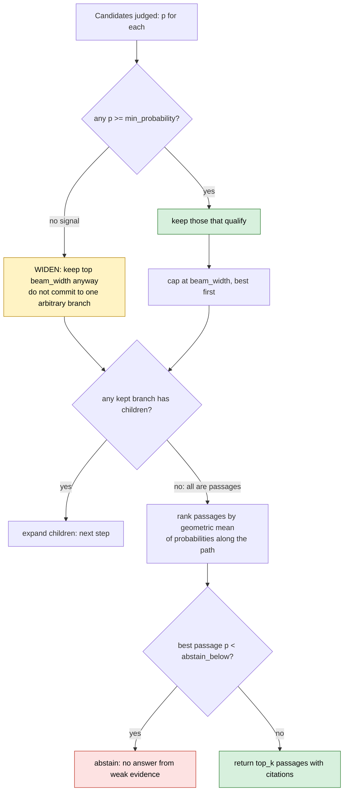
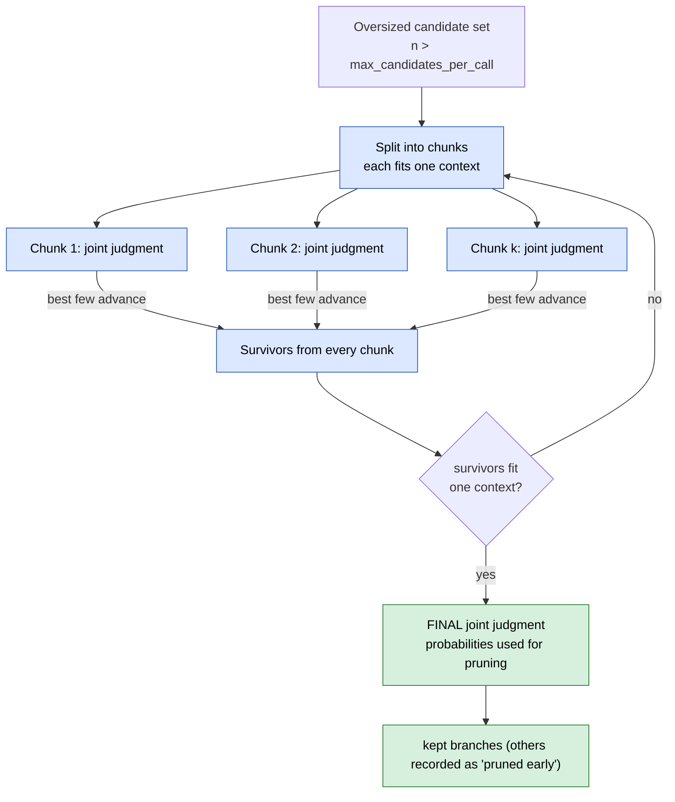
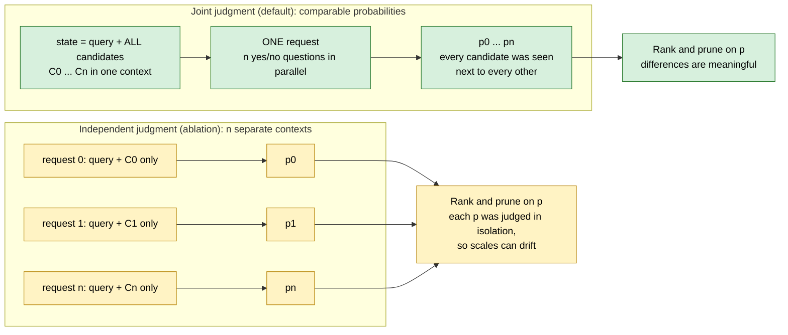

# Algorithm

All of it lives in [`navigator.py`](../src/decision_rag/navigator.py). Constants are in
`NavigationConfig`.

## Navigation

```text
frontier = [root]
repeat until no frontier branch has children:
    candidates = every child of every frontier branch
    p = decision_model.judge(query, candidates)        # ONE joint judgment (see tournament)
    keep = candidates with p >= min_probability, best first
    if keep is empty: keep = best candidates anyway    # no signal: widen, do not guess
    frontier = keep[:beam_width]
rank the passages reached by  geometric_mean(p along the path)
abstain if the best passage's last p < abstain_below, or none was reached
return top_k
```



### Why a probability product, not a sum

A passage is only useful if every ancestor was plausibly right, so the path score is the
**geometric mean** of the probabilities from topic to passage (the mean of logs, exponentiated).
One very unlikely ancestor drags it down; depth does not penalise it, because it is a mean, not a
raw product. The final passage probability is used separately for the abstain decision, so a
strong path to a weak passage still abstains.

### Why widen instead of picking one branch

If every candidate scores near zero, the model is saying "I cannot tell from these descriptions".
Committing to the single highest score would be an arbitrary bet that cannot be undone. Keeping
the top `beam_width` costs one extra level of judging and usually recovers, as in the poison
message trace in the [README](../README.md).

## Cost

One decision-model call per level when a level fits in a context. With depth `d`, a query makes
`d` calls (4 here), independent of corpus size. Latency is `d` times the model latency, plus the
tournament rounds below on wide levels.

## The tournament for oversized candidate sets

A real corpus can have thousands of documents under a topic, more than fits one context.
`max_candidates_per_call` bounds a single judgment. Larger sets run as a tournament:



Only the survivors of the last round get a probability, and the trace marks the rest
`pruned early`. This keeps every probability that drives pruning comparable (the final round is a
true joint judgment) at the cost of a few extra calls. It is this example's design; the paper's
treatment of very wide levels was not available when this was written.

## Joint vs independent judgments



The navigator always asks the decision model to judge a *set*. Whether that set is evaluated in
one context or one-by-one is the model adapter's choice, which is what makes the ablation a
configuration switch (`DECISION_RAG_JUDGEMENT`) rather than a code change.

## Descriptions are the index

There is no embedding index, but the model can only judge what it is shown. Each branch is shown
as `breadcrumb: description`, where the description is extractive:

- topic: its documents with their section titles
- document: its sections, each with the opening of its first passage
- section: the opening of its first passage
- passage: the passage text

If navigation misses, look at the trace for the level where the right branch got a low
probability, then improve that branch's title or description (or switch to a stronger model).

## Failure handling

| Event | Behaviour |
|---|---|
| decision model errors, times out or answers an invalid shape | `DecisionModelError`; the pipeline abstains with `decision_model_unavailable` |
| wrong number of judgments, or a probability outside 0..1 | `DecisionModelError` (validated before use) |
| no passage reached | abstain |
| best passage below `abstain_below` | abstain (`low_relevance`), no citations |

## Complexity and limits

- Memory: the whole tree is held in memory; for very large corpora, build the tree lazily or
  shard by topic.
- A leaf-level tie is broken by the last probability, then by order.
- The trace records every candidate, so its size is the number of candidates judged, not just
  the ones kept.
