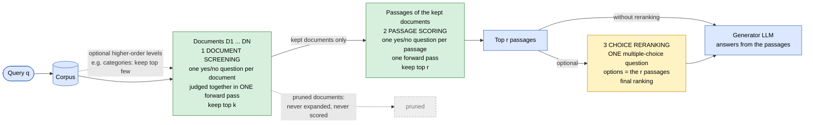
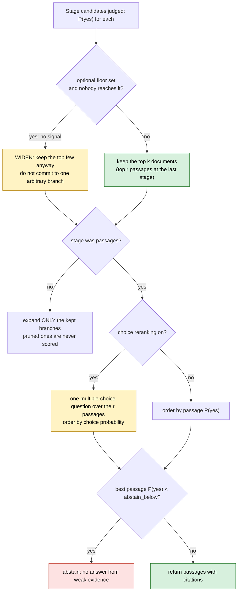
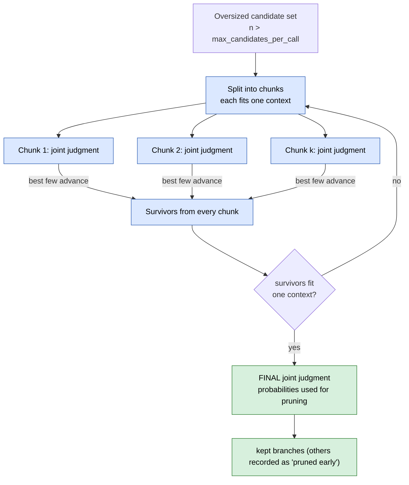
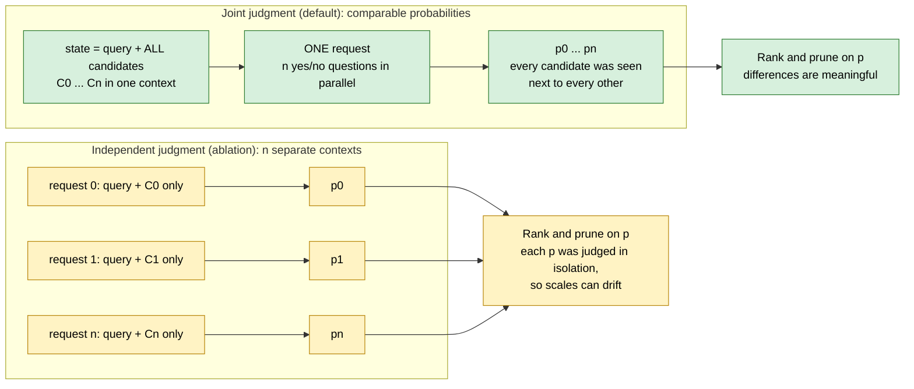

# Algorithm

All of it lives in [`navigator.py`](../src/decision_rag/navigator.py). Constants are in
`NavigationConfig`. The pipeline is the one in the paper's Figure 2(c); items marked **this
example** are additions that the figure does not show.



## Stages

1. **Optional higher-order levels** (for example categories or topics): one joint judgment over
   the corpus's top-level groups, keep `keep_topics`. If the corpus has only one group the model is
   not called at all (this example).
2. **Document screening**: one yes/no question per document under the kept groups, all in a single
   shared context, so one decision-model call. Keep the top **k** (`keep_documents`).
3. **Passage scoring**: one yes/no question per passage of the **kept documents only**, again one
   call. Pruned documents are never expanded, so their passages are never scored. Keep the top
   **r** (`keep_passages`).
4. **Optional choice reranking** (`rerank=True`): one multiple-choice question whose options are
   the r passages; the returned distribution gives the final order. Needs a model that implements
   `choose()`.

Sections sit between documents and passages in the tree. By default they are folded away
(`skip_sections=True`): passage scoring sees the passages of a kept document directly, with the
section title still in each candidate's breadcrumb. Set `skip_sections=False` to judge sections as
their own stage.

```text
frontier = [root]
for each stage (topics, documents, [sections], passages):
    candidates = children of every branch in the frontier (skipped kinds looked through)
    p = decision_model.judge(query, candidates)          # ONE joint judgment (see tournament)
    keep = top k (top r at the passage stage), best first
    frontier = keep                                      # pruned branches are never expanded
if rerank:  order = decision_model.choose(query, kept passages)   # ONE multiple-choice question
else:       order = kept passages by their own P(yes)
abstain if the best passage's P(yes) < abstain_below, or none was reached      # this example
```



### The keep rule

The figure's rule is "keep top k": no probability threshold. That is the default
(`min_probability=0`). **This example** adds an optional floor; if you set one and no candidate
reaches it, the top candidates are kept anyway, because "nothing looks relevant" means widen, not
commit to one arbitrary branch.

### Ranking

Passages are ordered by their own yes/no probability, or by the choice probability when reranking
is on. The paper's text that was available does not describe any path-level combination, so none is
used.

### Abstaining

Not in the paper. If the best passage's P(yes) is below `abstain_below`, the pipeline returns no
answer instead of the nearest weak match.

## Cost

One decision-model call per stage when the stage fits in a context. For a corpus with categories
that is up to three calls (categories, documents, passages), plus one for the optional rerank,
independent of corpus size. A step with only one candidate needs no call: it inherits its parent's
probability, because no evidence was gathered (the trace shows `0 call(s)`). With a single topic
and no rerank, a query costs two calls.

## Choice reranking vs yes/no scoring

Passage scoring asks each passage "is this relevant?" independently of the others' answers, even
though they share a context. Choice reranking asks one question, "which of these answers the
query?", so the model must trade the passages off against each other. The paper's Figure 2 lists
it as optional. The rerank costs one extra call over only r passages.

## The tournament for oversized candidate sets (this example)

A real corpus can have thousands of documents, more than fits one context. `max_candidates_per_call`
bounds a single judgment. Larger sets run as a tournament:



Only the survivors of the last round get a probability, and the trace marks the rest
`pruned early`. This keeps every probability that drives pruning comparable (the final round is a
true joint judgment) at the cost of a few extra calls. The paper's treatment of very wide stages
was not available when this was written.

## Joint vs independent judgments



The navigator always asks the decision model to judge a *set*. Whether that set is evaluated in
one context or one-by-one is the model adapter's choice, which is what makes the ablation a
configuration switch (`DECISION_RAG_JUDGEMENT`) rather than a code change.

## Descriptions are the index

There is no embedding index, but the model can only judge what it is shown. Each candidate is shown
as `breadcrumb: description`, where the description is extractive:

- topic: its documents with their section titles
- document: its sections, each with the opening of its first passage
- passage: the passage text, with its section title in the breadcrumb

If navigation misses, look at the trace for the stage where the right branch got a low
probability, then improve that branch's title or description, raise k, or use a stronger model.

## Failure handling

| Event | Behaviour |
|---|---|
| decision model errors, times out or answers an invalid shape | `DecisionModelError`; the pipeline abstains with `decision_model_unavailable` |
| wrong number of judgments, or a probability outside 0..1 | `DecisionModelError` (validated before use) |
| choice distribution of the wrong length, outside 0..1, or not summing to 1 | `DecisionModelError` |
| `rerank=True` with a model that cannot `choose()` | `ValueError` at construction |
| no passage reached | abstain |
| best passage below `abstain_below` | abstain (`low_relevance`), no citations |

## Limits

- The whole tree is held in memory; for very large corpora, build it lazily or shard by topic.
- Pure top-k always keeps k candidates, even when all are irrelevant. That costs extra passage
  scoring but never prunes the right branch for lack of a threshold.
- The trace records every candidate judged, so its size is the number of candidates, not only the
  kept ones.
