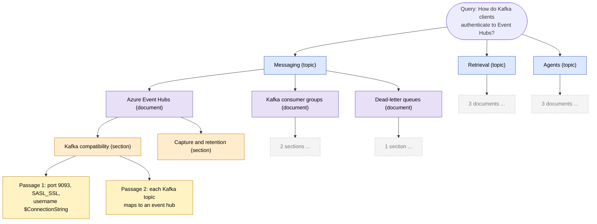

# Concepts

## The problem the paper starts from

Most retrieval scores each passage by term statistics (BM25) or by nearest neighbours in a fixed
embedding space. The retriever is far weaker than the model that will read its output, so there is
a **capability asymmetry**: whatever the retriever misses, the generator cannot recover.

Two partial answers exist. *Agentic* retrieval lets an LLM navigate step by step, but it
generates many tokens per step, which is slow and costly. *Rerankers* are cheaper but can only
reorder what a first-stage retriever already returned.

## Decision models

A decision model takes a context and a set of questions and returns, for each question, a
probability distribution over its answer options, without sampling any tokens. For a yes/no
question that is `P(yes)`. Many questions are answered in parallel against the shared context in a
single forward pass. TypeSafe's Jev is the example the paper cites; see the
[System One concepts](../../system_one_triage/docs/concepts.md) in this repo for the model family.

Two properties matter for retrieval:

- **Speed.** One forward pass per decision, no generation.
- **Comparability.** If you put every candidate in the *same* context, the model judges them
  against each other, so their probabilities can be ranked and pruned meaningfully. Scoring each
  candidate alone gives numbers from separate contexts, whose scales can drift.

## Retrieval as navigation

Most corpora already have structure: categories, document titles, sections, paragraphs. People use
it to find things. DecisionRAG does the same, one decision per level, so the cost is the *depth*
of the hierarchy (about four calls here) and not the number of passages.

| Level | Candidates the model sees | What a good description contains |
|---|---|---|
| topic | all topics | the documents and their section titles |
| document | documents under the kept topics | its sections and the opening of each |
| section | sections under the kept documents | the opening of its first passage |
| passage | passages under the kept sections | the passage text |

## When to use it

Good fit: documentation, manuals, policies, wikis, knowledge bases, and any corpus with real
titles and headings; questions that a person could answer by browsing; settings where you cannot
or do not want to maintain an embedding index.

Poor fit: flat, unlabelled text; corpora where the answer hinges on an exact rare token that no
title or heading mentions (use lexical search for that); very high query volume where even a few
model calls per query are too expensive.

It also composes: navigation can supply candidates to a reranker, or a lexical search can seed
a tree.

## What is and is not from the paper

| From the paper (as read) | This example's own design |
|---|---|
| decision models judge candidates jointly in one forward pass, no tokens | beam search over levels, `beam_width`, `min_probability` |
| shared context makes estimates comparable | widening the beam when no candidate looks relevant |
| navigate topics to passages by hierarchical decisions | tournament for candidate sets larger than a context |
| no first-stage retriever, precomputed index or task training | geometric-mean ranking, abstain threshold |
| reported benchmark results | extractive descriptions of branches built from titles and openings |
