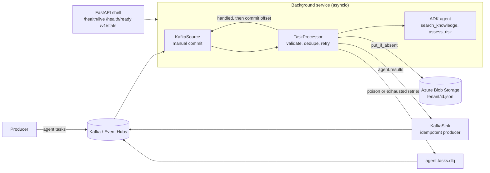

# Event worker: Kafka, Azure and a background service

An ADK agent that runs unattended. A background service consumes task events from Kafka (Apache
Kafka locally, **Azure Event Hubs** through its Kafka endpoint in Azure), runs the agent, stores
each result once in **Azure Blob Storage**, and publishes it to a results topic. Work that cannot
succeed goes to a dead-letter topic.



## Delivery guarantees

| Concern | Behaviour |
|---|---|
| Delivery | At-least-once. The offset is committed only after the result is stored and published |
| Idempotency | The Blob record `tenant/id.json` is written once (`overwrite=False`). A redelivered event republishes the stored record and does **not** run the agent again. Downstream consumers should still dedupe on `event_id` |
| Transient failure | Up to `EVENTS_MAX_ATTEMPTS` with exponential backoff and a per-attempt timeout |
| Poison message | Invalid JSON, empty question, or an unsafe id (`/`, `..`) is dead-lettered immediately, never retried |
| Broker or storage outage | The loop stops, `/health/live` fails, the pod restarts and the uncommitted message is redelivered |
| Shutdown | SIGTERM finishes the current message, then stops consumer, producer and storage clients |
| Scaling | Run more replicas in one consumer group, up to the topic's partition count |

## Run locally with no infrastructure

```bash
make install
uv run python -m event_worker                  # in-memory backend, headless
uv run --package agentverse-event-worker uvicorn event_worker.app:create_app --factory
```

## Run against Kafka and Azurite (Azure Storage emulator)

```bash
docker compose -f agents/event_worker/docker-compose.yml up --build
# send a task
docker compose -f agents/event_worker/docker-compose.yml exec redpanda \
  rpk topic produce agent.tasks <<< '{"id":"t1","tenant_id":"demo","question":"What is hybrid RAG?"}'
# read the result
docker compose -f agents/event_worker/docker-compose.yml exec redpanda rpk topic consume agent.results -n 1
```

## Run on Azure

| Setting | Value |
|---|---|
| `EVENTS_BACKEND` | `azure` |
| `EVENTS_KAFKA_BOOTSTRAP_SERVERS` | `<namespace>.servicebus.windows.net:9093` |
| `EVENTS_KAFKA_SECURITY_PROTOCOL` | `SASL_SSL` |
| `EVENTS_EVENTHUBS_CONNECTION_STRING` | Event Hubs connection string (from Key Vault, never in git) |
| `EVENTS_BLOB_ACCOUNT_URL` | `https://<account>.blob.core.windows.net`, authenticated with `DefaultAzureCredential` (managed or workload identity; grant it *Storage Blob Data Contributor*) |

Event Hubs maps Kafka topics to event hubs, so create `agent.tasks`, `agent.results` and
`agent.tasks.dlq` as event hubs in the namespace first.

## Models

`EVENTS_RESPONDER=knowledge` (default) is deterministic and offline. `adk` runs
`event_worker.adk_agent:root_agent` per task in an isolated ADK session and needs
`GOOGLE_API_KEY` or Vertex AI credentials. The ADK path is wired but is not exercised by the
automated tests, which need no model; verify it with a real key before relying on it.

## Layout

```text
src/event_worker/
  ports.py            protocols: MessageSource, MessageSink, ResultStore, Responder
  processor.py        validate, dedupe, retry, dead-letter (all the logic)
  service.py          background loop, commit-after-handle, adapter wiring
  kafka_adapters.py   aiokafka consumer/producer, Event Hubs SASL settings
  azure_store.py      Blob Storage result store
  memory.py           in-memory adapters (local runs, tests)
  responders.py       offline knowledge responder and ADK responder
  adk_agent.py        root_agent for Agents CLI
  app.py              FastAPI health and stats shell around the background task
```

Tests run with no Kafka, Azure or model: `uv run pytest agents/event_worker`.
