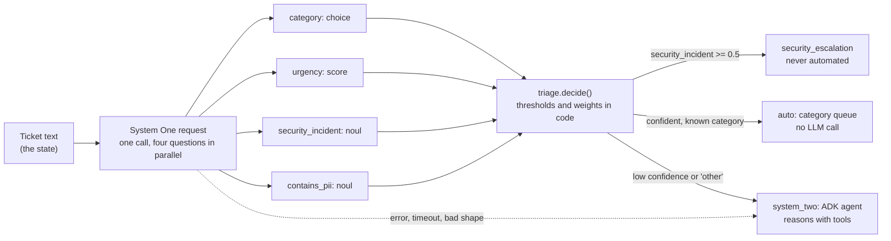

# System One triage: fast typed decisions, plain-code routing

A worked example of building with a **System One model**: TypeSafe's **Jev**. Instead of asking
an LLM to write text and then parsing it, you send Jev a *state* and a set of *typed questions*
and get back typed answers (a choice, a score, a probability) with calibrated probabilities and,
for some types, a confidence. Your code branches on them directly.

This example triages support tickets. Four atomic questions are answered in one request; ordinary
code combines them and decides where the ticket goes. Only the cases that need real reasoning
reach the ADK (System Two) agent.



## Why this shape

| Idea (from the Jev docs) | Where it shows up here |
|---|---|
| Atomic questions, composed in code | `triage.build_questions()` asks four narrow gut-checks, not "triage this ticket" |
| Probabilities and confidence are for branching | `decide()` auto-handles only if `category.confidence >= 0.7` |
| Change a coefficient, not a prompt | `TriagePolicy` holds every threshold and weight; tests prove the route flips when they change |
| Questions run in parallel and in isolation | one HTTP request, so adding a question adds almost no latency |
| System One for speed, a reasoning model where needed | `Route.AUTO` skips the LLM; `Route.SYSTEM_TWO` hands off to the ADK agent |

## Quick start

No key or network needed; the default backend is an offline stand-in.

```bash
make install
uv run python -m system_one_triage "I was charged twice, please refund the invoice"
uv run pytest agents/system_one_triage
uv run --package agentverse-system-one-triage uvicorn system_one_triage.app:create_app --factory
curl -s localhost:8000/v1/triage -H 'content-type: application/json' \
  -d '{"text":"Our production API is down and customers cannot log in"}'
```

Example output (offline stand-in; real Jev probabilities will differ):

```json
{
  "route": "auto",
  "queue": "billing",
  "priority": 0.184,
  "contains_pii": false,
  "reasons": ["confident_category"],
  "facts": {
    "category": "billing",
    "category_confidence": 0.886,
    "urgency": 1.0,
    "security_incident": 0.03,
    "contains_pii": 0.05
  }
}
```

### Use real Jev

Jev is hosted and in early access; request a key from TypeSafe, then:

```bash
export SYSTEM_ONE_BACKEND=jev
export SYSTEM_ONE_API_KEY=...        # never commit; use your secret manager
uv run python -m system_one_triage "Is it possible to export invoices as CSV?"
```

**Read [docs/wire-contract.md](docs/wire-contract.md) first.** The request and response field
names were confirmed only partly; the contract file says which parts are verified and how to
adjust the single module that depends on them.

## Safety properties

| Concern | Behaviour |
|---|---|
| Security incidents | `security_incident >= 0.5` routes to `security_escalation` regardless of category |
| System One down, slow or misread | any `SystemOneError` routes to the agent with reason `system_one_unavailable`; nothing is auto-handled on a guess |
| Malformed answers | decoding validates option names, ranges and that probabilities sum to 1; otherwise `WireFormatError` |
| Personal data | the ticket text is never logged, and error messages never include it or the response body; `contains_pii` flags it so downstream code can redact |
| Secrets | the API key is a `SecretStr`, sent only as a bearer header |
| Prompt injection | ticket text is only ever the *state*; the agent is told to treat it as untrusted data |

## Layout

```text
src/system_one_triage/
  questions.py     Choice / Score / Noul and their typed answers
  wire.py          the only module that knows the HTTP JSON shape (encode + strict decode)
  http_client.py   JevHttpClient: POST /v1/systemone, bearer auth, timeouts, safe errors
  local.py         offline keyword stand-in (NOT Jev) for demos and tests
  triage.py        build_questions(), TriagePolicy, decide(), triage(): the routing logic
  adk_agent.py     System Two agent with a triage_ticket tool (agents-cli entrypoint)
  app.py           FastAPI endpoint POST /v1/triage
tests/             wire, HTTP client (mock transport), routing policy, agent and endpoint
docs/              concepts, wire contract, extending and evaluating
```

## More

- [Concepts](docs/concepts.md): System One vs System Two, the three question types, decomposition
- [Wire contract](docs/wire-contract.md): what is verified, what is assumed, how to confirm it
- [Extending and evaluating](docs/extending.md): add a question, tune thresholds, calibrate with data

## Sources

- TypeSafe Jev introduction and System One API reference: <https://docs.typesafe.ai/api/system-one>
- Secondary write-ups used for field names (unverified): [DataCamp](https://www.datacamp.com/blog/system-one-models-jev), [MarkTechPost](https://www.marktechpost.com/2026/09/19/typesafe-ai-releases-jev/), [DigitalOcean](https://docs.digitalocean.com/products/inference/how-to/use-system-one-api/)
