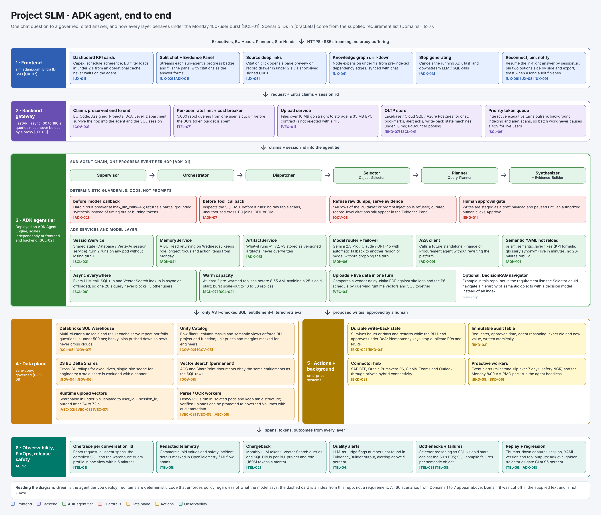
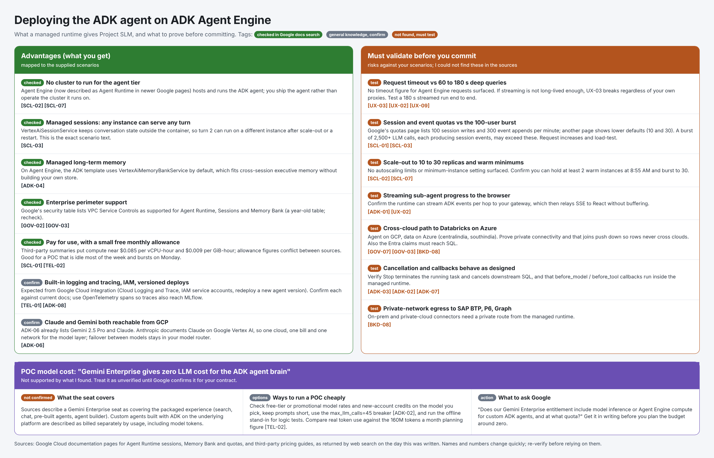

# Project SLM: ADK agent end to end

Two pictures built **only from the supplied scenario list** (Domains 1 to 7, 60 scenarios). Domain 8
was cut off mid-sentence in the supplied text (`[MNT-01] Onboardin`), so it is not covered. Nothing
else from the original text is included.

## 1. The ADK agent, end to end

Seven layers, top to bottom: frontend, backend gateway, the ADK agent tier (sub-agent chain,
deterministic guardrails, ADK services, model layer), the governed data plane, enterprise actions
and background work, and observability. Red cards are policy enforced in code, whatever the model
says. The dashed card is an idea from this repository, not a requirement.

## 2. Advantages of deploying on ADK Agent Engine, and what to validate

The left column lists what a managed runtime gives you, tagged by how well it is supported. The
right column lists risks against specific scenarios that **no source I could find answered**, so
they need a test before you commit. The most important:

| Risk | Why it matters | Scenarios |
|---|---|---|
| Request timeout on long streamed queries | 60 to 180 s answers must not be cut off | UX-03, UX-02, UX-09 |
| Session and event quotas | Google lists per-minute caps (100 session writes, 300 event appends on one page; lower defaults on another) that a 100-user burst may hit | SCL-01, SCL-03 |
| Scale-out and warm minimums | 10 to 30 replicas and at least 2 warm instances at 8:55 AM | SCL-02, SCL-07 |
| Cross-cloud path | Agent on GCP, data on Azure Databricks: private connectivity and push-down joins | GOV-07, GOV-03, BKD-08 |

### Using a Gemini Enterprise seat as the model, for free

Not supported by what I found. Sources describe a Gemini Enterprise seat as covering its packaged
experience, and custom ADK agents on the underlying platform as billed separately by usage. Ask
Google whether your entitlement covers model inference or Agent Engine compute for custom ADK
agents, and get the answer in writing before budgeting around zero. For a POC, check free-tier
rates and credits for the model you choose, and keep the `max_llm_calls=45` breaker (ADK-02).

## Where each scenario sits in the diagram

| ID | Scenario | Where in the diagram |
|---|---|---|
| ADK-01 | Sub-Agent Hand-Off Visibility | 1 · Frontend: Split chat + Evidence Panel |
| ADK-02 | Runaway Agent Loop Protection (max_llm_calls=45) | 3 · ADK agent tier: before_model_callback |
| ADK-03 | User Mid-Flight Cancellation ("Stop Generating") | 1 · Frontend: Stop generating |
| ADK-04 | Cross-Session Executive Memory (MemoryService) | 3 · ADK agent tier: MemoryService |
| ADK-05 | Versioned Session Artifacts (ArtifactService) | 3 · ADK agent tier: ArtifactService |
| ADK-06 | Multi-Model Routing & Automatic Failover | 3 · ADK agent tier: Model router + failover |
| ADK-07 | Deterministic Guardrail Callbacks (before_tool_callback) | 3 · ADK agent tier: before_tool_callback |
| ADK-08 | Golden Trajectory Regression Testing (adk eval) | 6 · Observability, FinOps, release safety: Replay + regression |
| ADK-09 | Future Cross-BU Agent Federation (A2A Protocol) | 3 · ADK agent tier: A2A client |
| ADK-10 | Hot-Reloading Prompts & Semantic YAMLs | 3 · ADK agent tier: Semantic YAML hot reload |
| TEL-01 | End-to-End Trace Correlation (UI → ADK → SQL) | 6 · Observability, FinOps, release safety: One trace per conversation_id |
| TEL-02 | Per-BU & Per-Project Token Chargeback (160M Tokens/Mo) | 6 · Observability, FinOps, release safety: Chargeback |
| TEL-03 | Sub-Agent Bottleneck Pinpointing | 6 · Observability, FinOps, release safety: Bottlenecks + failures |
| TEL-04 | Automated Hallucination & Citation Drift Alerts (AC-02, AC-04) | 6 · Observability, FinOps, release safety: Quality alerts |
| TEL-05 | Sensitive Data Redaction in Telemetry Spans | 6 · Observability, FinOps, release safety: Redacted telemetry |
| TEL-06 | Negative Feedback & "Thumbs Down" Replay | 6 · Observability, FinOps, release safety: Replay + regression |
| TEL-07 | Real-Time Quota & Cost Anomaly Circuit Breaker | 2 · Backend gateway: Per-user rate limit + cost breaker |
| TEL-08 | Tool Error Rate & SQL Compilation Failure Dashboards | 6 · Observability, FinOps, release safety: Bottlenecks + failures |
| GOV-01 | Blocking Raw Row Dumps While Serving Verifiable Evidence | 3 · ADK agent tier: Refuse raw dumps, serve evidence |
| GOV-02 | Enforcing Per-User BU & Project Isolation Over Delta Shares (AC-10) | 4 · Data plane: Unity Catalog |
| GOV-03 | Preserving Corporate Entra ID Claims Across the Backend → Agent → SQL Hop | 2 · Backend gateway: Claims preserved end to end |
| GOV-04 | Cross-BU Executive Rollup vs. Single-Site Restriction | 4 · Data plane: 23 BU Delta Shares |
| GOV-05 | Column-Level Masking of Commercial & Margin Data | 4 · Data plane: Unity Catalog |
| GOV-06 | Graceful Degradation When One BU's Delta Share Is Stale or Broken | 4 · Data plane: 23 BU Delta Shares |
| GOV-07 | Cross-Cloud / Cross-Region Egress Control on Delta Shares | 4 · Data plane: Databricks SQL Warehouse |
| GOV-08 | Unstructured Document Entitlement Parity (DP-01 ACC, DP-09 SharePoint) | 4 · Data plane: Vector Search (permanent) |
| GOV-09 | Zero-Copy Governance Without Duplicating 23 BU Warehouses | 4 · Data plane: layer heading (zero-copy, governed) |
| VEC-01 | Uploading Large Engineering Documents (>10 MB to 100 MB) | 2 · Backend gateway: Upload service |
| VEC-02 | Sub-5-Second Runtime Vectorization (Bypassing Batch Index Lag) | 4 · Data plane: Runtime upload vectors |
| VEC-03 | Strict Session Isolation of "What-If" Uploaded Files | 4 · Data plane: Runtime upload vectors |
| VEC-04 | Cross-Referencing Uploaded Files Against Live Delta-Shared SQL Data | 3 · ADK agent tier: Uploads + live data in one turn |
| VEC-05 | Complex Table & Engineering Drawing Extraction (OCR / Vision) | 4 · Data plane: Parse / OCR workers |
| VEC-06 | Controlled Promotion of Verified Uploads to Permanent BU Knowledge Base | 4 · Data plane: Parse / OCR workers |
| VEC-07 | Automatic Ephemeral Cleanup & TTL Governance | 4 · Data plane: Runtime upload vectors |
| VEC-08 | CPU/Memory Isolation for Heavy Document Parsing | 4 · Data plane: Parse / OCR workers |
| UX-01 | Dual-Speed Experience (<2s Dashboard vs. 10s–60s Deep Agent Chat) | 1 · Frontend: Dashboard KPI cards |
| UX-02 | Real-Time Streaming of Intermediate Reasoning & Citations (SSE) | 1 · Frontend: Split chat + Evidence Panel |
| UX-03 | Zero 502/504 Gateway Timeouts on 60s–180s Deep Queries | 2 · Backend gateway: layer heading (60 to 180 s queries must never be cut by a proxy) |
| UX-04 | Interactive Mind-Map / Knowledge Graph Drill-Down (<1s Node Expansion) | 1 · Frontend: Knowledge graph drill-down |
| UX-05 | Deep-Linking from Evidence Citations to Original Source Pages | 1 · Frontend: Source deep links |
| UX-06 | Resilient Mobile / Site-Office Reconnection | 1 · Frontend: Reconnect, pin, notify |
| UX-07 | Custom Corporate Domain (slm.adani.com) & Seamless SSO | 1 · Frontend: layer heading (slm.adani.com, Entra ID SSO) |
| UX-08 | Side-by-Side Scenario Comparison Pinning | 1 · Frontend: Reconnect, pin, notify |
| UX-09 | Asynchronous "Notify Me When Ready" for Ultra-Deep Portfolio Audits | 1 · Frontend: Reconnect, pin, notify |
| BKD-01 | Human-in-the-Loop Approval Gate Before Enterprise Write-Back (AC-09) | 3 · ADK agent tier: Human approval gate |
| BKD-02 | Long-Lived Durable Agent Pause (Hours/Days) Across Approval Routing | 5 · Actions + background: Durable write-back state |
| BKD-03 | 100% Tamper-Proof Before/After Write-Back Audit Trail (AC-09) | 5 · Actions + background: Immutable audit table |
| BKD-04 | Transactional Idempotency on External ERP/P6 APIs | 5 · Actions + background: Durable write-back state |
| BKD-05 | Event-Driven Proactive Threshold Alerts (Use Case 6) | 5 · Actions + background: Proactive workers |
| BKD-06 | Automated Monday 8:00 AM PMO Governance Pack Generation (Use Case 7) | 5 · Actions + background: Proactive workers |
| BKD-07 | Read/Write Workload Separation (Transactional OLTP vs. Analytical OLAP) | 2 · Backend gateway: OLTP store |
| BKD-08 | Outbound Enterprise Connector Hub (SAP BTP, Primavera P6, Teams/Email) | 5 · Actions + background: Connector hub |
| SCL-01 | The Monday 9:30 AM 100-User Governance Burst (2,500+ LLM Calls) | Diagram subtitle (the Monday 100-user burst the whole design is checked against) |
| SCL-02 | Independent Horizontal Autoscaling of Frontend, Backend, and ADK Agent Tiers | 3 · ADK agent tier: Warm capacity |
| SCL-03 | Zero-Amnesia Pod Scaling & Load Balancing | 3 · ADK agent tier: SessionService |
| SCL-04 | Database Connection Pool Protection (PgBouncer / Lakebase Limits) | 2 · Backend gateway: OLTP store |
| SCL-05 | Databricks SQL Warehouse Multi-Cluster Scaling & Result Caching | 4 · Data plane: Databricks SQL Warehouse |
| SCL-06 | Provisioned LLM Throughput & Priority Token Queuing | 2 · Backend gateway: Priority token queue |
| SCL-07 | Pre-Warmed Replicas to Eliminate Cold-Start Penalties | 3 · ADK agent tier: Warm capacity |
| SCL-08 | Non-Blocking Async I/O Across All Tool Calls | 3 · ADK agent tier: Async everywhere |

## Regenerating the images

The sources are plain HTML in [diagrams](diagrams). Render with any headless Chromium, for example
Playwright: open the file and screenshot the `#poster` element at 1.5x. The test
`agents/decision_rag/tests/test_project_slm_docs.py` fails if a scenario is missing from the
diagram or the PNGs are missing.

## Try the scenarios with DecisionRAG

The same 60 scenarios are the sample data for the DecisionRAG example, as Markdown and as a PDF.
See [agents/decision_rag/README.md](../../agents/decision_rag/README.md).
